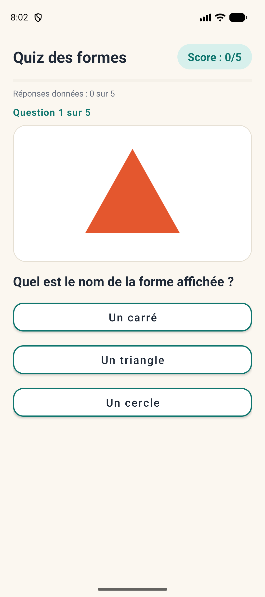
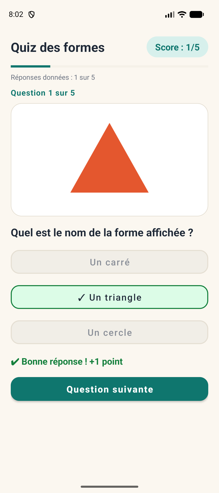
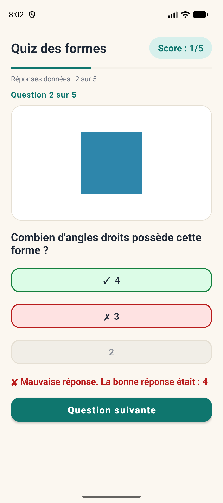
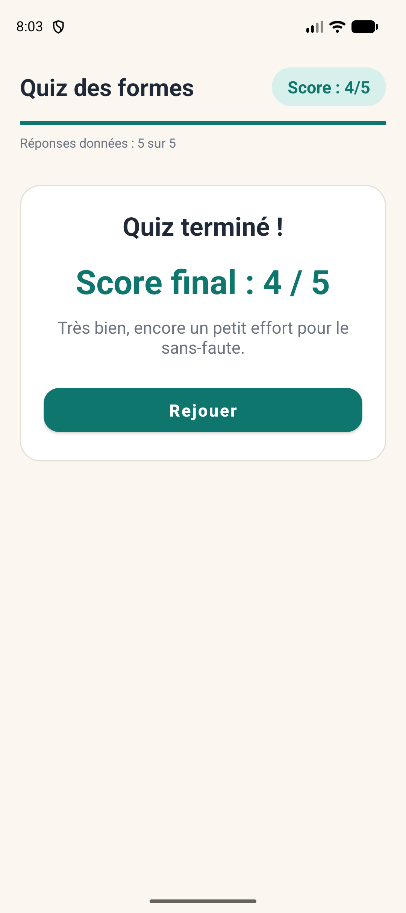
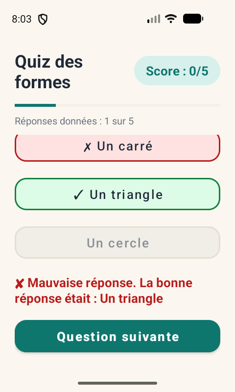

# Quiz en images — TP Android (Kotlin & XML)

Jeu de quiz de **cinq questions illustrées** sur le thème des **formes géométriques**.
Pour chaque question, l'utilisateur observe une image et choisit une réponse parmi **trois boutons**.
Chaque bonne réponse rapporte 1 point ; le score et la progression sont visibles en permanence ;
le score final s'affiche à la fin de la partie, avec un bouton **Rejouer**.

> Navigation rapide : [Compte rendu](compte-rendu/compte-rendu.md) ([PDF](compte-rendu/compte-rendu.pdf)) ·
> [Captures d'écran](captures/README.md) · [Code Kotlin](app/src/main/java/com/example/quizimages/) ·
> [Layout XML](app/src/main/res/layout/activity_main.xml)

## Captures d'écran

Captures réelles de l'application lancée sur un émulateur (Pixel 9a, Android 16).

| Question | Bonne réponse | Mauvaise réponse | Résultat final |
|:-:|:-:|:-:|:-:|
|  |  |  |  |

Sur un petit écran (480 × 800), la zone de la question défile et les trois choix restent accessibles :



## Fonctionnalités

- Une seule activité `MainActivity`, **sans fragment** et **sans Jetpack Compose** (interface 100 % XML).
- Cinq questions statiques déclarées dans un tableau Kotlin (`Array<Question>`), chacune avec son image
  dans `res/drawable` (`triangle`, `carre`, `cercle`, `etoile`, `rectangle`).
- Trois boutons de choix par question ; la bonne réponse n'est pas toujours au même endroit.
- Score en haut à droite, `ProgressBar` horizontale (nombre de **réponses données**, pas de bonnes réponses).
- Correction lisible après chaque réponse : message écrit (« ✔ Bonne réponse » / « ✘ Mauvaise réponse… »)
  et marque ✓ / ✗ sur le bouton — la couleur complète le message mais n'est pas le seul indice.
- Les trois boutons sont désactivés après la réponse : **un seul point maximum par question**.
- « Question suivante » n'apparaît qu'après une réponse ; à la dernière question, le bouton devient « Voir le résultat ».
- Écran final dans la même activité (choix masqués), score entre 0 et 5, bouton **Rejouer**.
- Bandeau fixe (titre, score, progression) + zone défilante pour les petits écrans.
- Amélioration facultative réalisée : la partie survit à la rotation (`onSaveInstanceState`).
- Pas de base de données, pas de serveur, aucun téléchargement.

## Ouvrir et lancer le projet

1. Installer **Android Studio** (version récente) avec un SDK Android 35.
2. `File > Open…` puis choisir le dossier `QuizImages` (celui qui contient `settings.gradle.kts`).
3. Laisser la synchronisation Gradle se terminer (le Gradle Wrapper 8.9 est inclus et se télécharge tout seul).
4. Lancer avec **Run ▶** sur un émulateur ou un téléphone (API 24 minimum).

En ligne de commande, depuis le dossier du projet :

```bash
./gradlew assembleDebug        # Windows : gradlew.bat assembleDebug
```

L'APK de debug est généré dans `app/build/outputs/apk/debug/`.

## Structure du dépôt

```
QuizImages/
├── app/
│   ├── build.gradle.kts
│   └── src/main/
│       ├── AndroidManifest.xml
│       ├── java/com/example/quizimages/
│       │   ├── MainActivity.kt        # déroulement du quiz, score, progression
│       │   └── Question.kt            # structure d'une question
│       └── res/
│           ├── layout/activity_main.xml
│           ├── drawable/              # triangle, carre, cercle, etoile, rectangle (vectoriels)
│           └── values/                # strings, colors, themes
├── captures/                          # captures d'écran (voir captures/README.md)
├── compte-rendu/                      # compte rendu (Markdown + PDF)
├── gradle/wrapper/, gradlew, gradlew.bat
├── build.gradle.kts, settings.gradle.kts, gradle.properties
└── .gitignore                         # exclut build/, .gradle/ et local.properties
```

## Auteur

Obaid Allah — ISET Djerba.
# QuizImages
